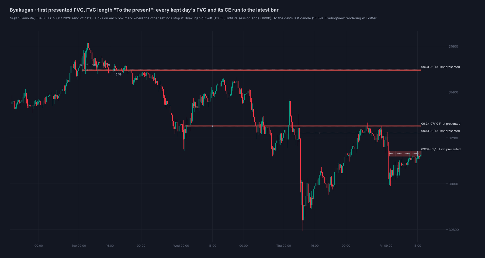
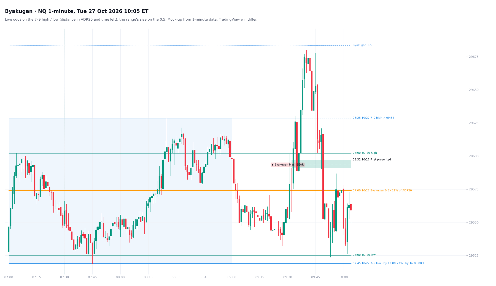
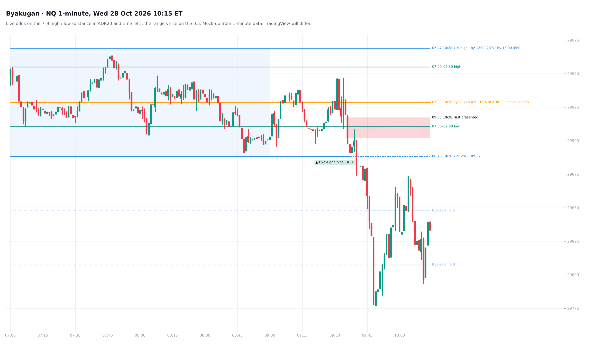
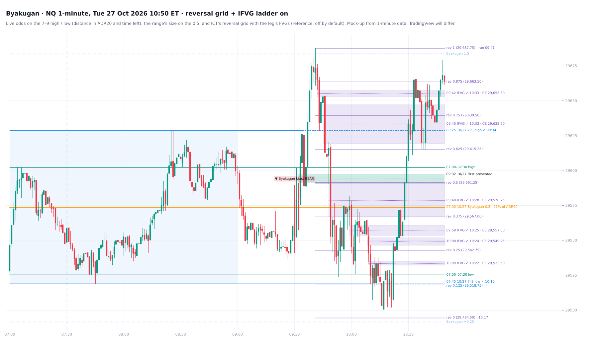
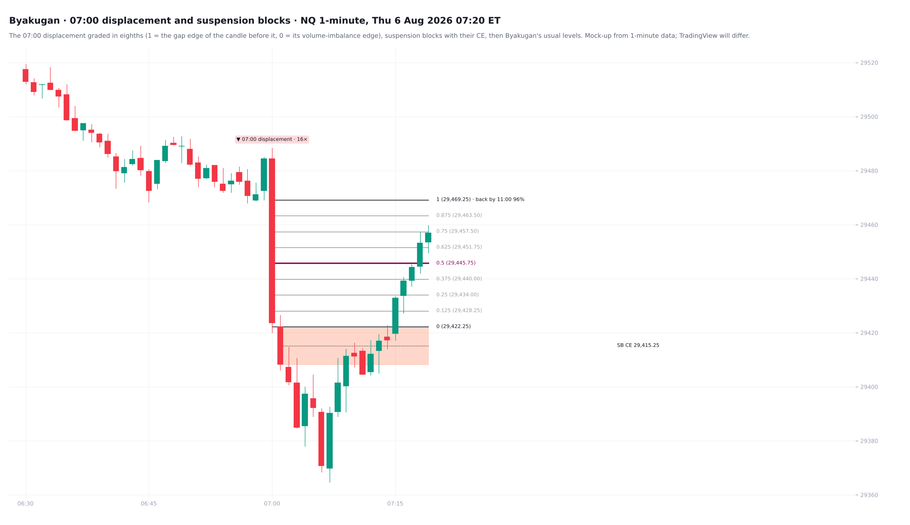
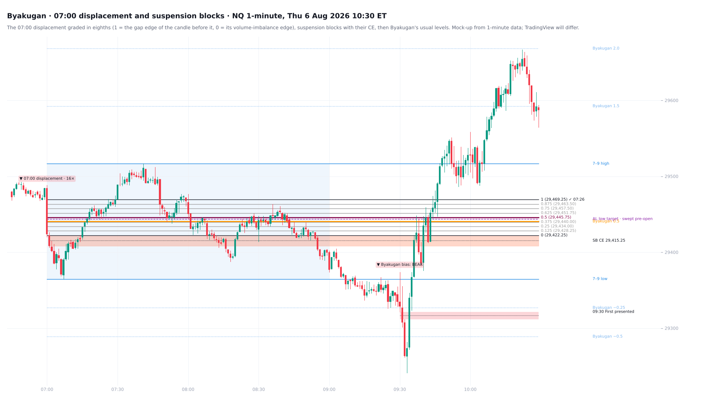

# Byakugan

**The 7-9 AM range and the first presented FVG for NQ and ES**

TradingView indicator, Pine Script v6. Open source under the Mozilla Public License 2.0.

Files: `Byakugan_FPFVG.pine` (the script, v3), `TradingView_description.txt` (publication text), `research/` (test scripts; no market data included).

*Mock-up of how it looks on the chart.*

**Byakugan** reads the 07:00–09:00 ET premarket range and the first presented fair value gap of the session. From 09:00 the range's high and low carry live odds of trading by 12:00 and 16:00. On 1-minute charts it also grades the 07:00 displacement and marks suspension blocks.

## What it draws

**The 7–9 AM range** (07:00–09:00 ET), drawn while it forms (the box grows with price, its 0.5 forming inside), then:
- its high, low and midpoint (0.5);
- from 09:00, **live odds** on the high and low: the chance each one trades by 12:00 and by 16:00, then ✓ and the time once it does ([below](#the-79-range-as-a-consolidation-ict-27-oct-2026));
- on the 0.5, the range's size as a share of ADR20, tagged **consolidation** at 20% or less and **wide** above 28%;
- an optional shaded box;
- levels that run from the range open to the cut-off (11:00 ET by default).

**The first 30 minutes** (07:00–07:30): its high and low, drawn as they form and run to the cut-off, with an optional EQ and a vertical line at 07:30. NQ + ES + RTY 2018–26:
- it already held the 7–9 high on 31% of days and the 7–9 low on 31%;
- by 09:00 one side was taken on 58% of days and both on 40% (neither: 2%);
- by 11:00 at least one side was taken on 99.9% of days, both on 76%;
- on average it is 46% of the full 7–9 range.

**Its EQ against the Byakugan 0.5, tested** (FOMC, CPI and NFP days left out, 5,443 days):
- **No directional edge.** Whether the first 30 minutes' EQ sits above or below the Byakugan 0.5 says nothing about the NY AM direction, the day's direction, the 16:00 close against the 0.5, or how often the 09:30 bias is right.
- **Which 7–9 extreme goes first.** It points to the side the range grew to after 07:30: about 65%, and 73% when the two EQs are a quarter of the range apart. But that is where price already is. Against a random walk from the 09:30 open it adds 3 points (p 0.07), not enough to call an edge.

**Labels** at the same spot and nearly the same price (within 0.5% of ADR20) share one label, listed top to bottom (the Session Map's fix).

**Extensions** in multiples of the range:
- 1.5, 2.0 and 2.5 in the direction of travel;
- −0.25, −0.5, −1.25 and −1.5 beyond the origin;
- your own custom levels.

**The 09:30 bias:** the open against the midpoint.

**The Asia / London target:** the Asia (20:00–00:00) or London (02:00–05:00) high or low in the bias direction, with its distance zone tagged on the label.

**The first presented FVG:** the first fair value gap of the session (09:30–16:00 by default) that completes within 30 minutes of the open. It is drawn with its CE (50%) and its reflection, the first opposite-direction FVG after it. The FVG can run to:
- the Byakugan cut-off (11:00);
- the session end (16:00);
- the trading day's last candle (16:59);
- the present.

## The 7–9 range as a consolidation (ICT, 27 Oct 2026)

From ICT's "NQ Futures Price Action Commentary". He asks what the 7–9 schematic is and answers "It's consolidation. Perfect.", then projects its standard deviations:
- **The range:** 29,519.00 (07:45) to 29,628.75 (08:25).
- **The 1.5:** 29,683.62. The first break went up at 09:34 and the run topped at 29,687.75 at 09:41.
- **The other side:** the 7–9 low traded at 10:10, and the leg bottomed at 29,494.50 at 10:17.
- **His grid of that leg:** graded in eighths, the 0.625 is 29,615.25. The 10:38 low printed 29,615.00.

All of this reproduces to the tick from the 1-minute data.

*10:05: the 7–9 high is ✓ (09:34). The low shows its odds: 73% by 12:00 and 80% by 16:00. It traded at 10:10.*

**What the tests showed** (NQ, ES and RTY 1-minute, 2018–26, about 6,400 days). Each claim is scored against the same day's 09:00–16:00 bars shuffled within each 30 minutes. That keeps the size of the moves and the day's volatility profile but removes their order, so an edge has to beat the shuffle.

- **The other side does not pull.** After the first break, the other side traded by 12:00 on 48.2% of days (shuffled 48.2%) and by 16:00 on 58.7% (58.8%).
- **The 1.5 does not mark the turn.** The first run reached the 1.5 before the other side on 64.9% of days (64.4%). After that, the other side traded on 41.9% (41.3%).
  - Run ends do not pile up at the 1.5: 1.4–1.6 holds 10.5% of them (9.8%).
  - The real difference is fewer breaks failing just past the edge: 1.0–1.1 holds 7.8% (9.3%). The surplus is spread from 1.2 to 1.8.
- **Consolidation helps the projection, not the reversal.** Measured as the 7–9 range against ADR20, the tighter the range, the more often the first break carried to the 1.5 before the other side traded:
  - 20% of ADR20 or less (2,543 days): 69.6% (shuffled 67.0%);
  - over 28%: 58.4% (59.7%);
  - as a slope, z 4.4, with the same sign on NQ (z 3.4), ES (2.9) and RTY (1.4).

  On tight mornings the other side was not likelier to trade than chance (68.2% vs 69.6% by 16:00). Fifteen other definitions of consolidation gave nothing beyond the shuffle on the other side (the largest gap was +2.1 points, z 1.8). Among them: a choppy 7–9, a 7–9 inside the overnight range or inside yesterday's range, an inside day, a tight 3-, 5-, 10- or 20-day box, a sideways month and a quiet London.
- **What does hold: distance and time.** The live odds on the high and low come from the distance to price in ADR20 and the time left. They were fitted on 2018–24 and scored on 2025–26:
  - against time alone, the Brier score fell from 0.177 to 0.146 by 12:00 and from 0.158 to 0.130 by 16:00;
  - predictions landed within about 4 points of the actual rate in every band.

  Adding the consolidation measures changed nothing (0.1460 and 0.1301 either way). Consolidation mornings already get higher odds because both sides sit closer.

*28 Oct: the 7–9 range was 15% of ADR20, tagged consolidation. The first break (down, 09:37) ran through the 1.5 and the 2.0 before 09:50. The high shows 26% by 12:00 and 45% by 16:00.*

**ICT's reversal grid and IFVG ladder** (reference, off by default). Once the first break's run is over and price trades through the other side:
- **The grid:** the leg from the run's extreme (1) to the new extreme beyond the other side (0), in eighths. The 0 follows price until it retraces to the 0.5, then the grid is fixed and runs to 16:00.
- **The ladder:** every fair value gap printed in that leg, carried right with its CE, ICT's "fireman's ladder". Once a candle closes back through a gap, it is marked inverted (IFVG ✓) with the time.

Both are kept for the latest day only. Neither is a tested level. In earlier tests, the eighths of opening ranges and gaps turned price no more often than placebo levels (50.9% vs 50.4%).

*27 Oct, grid and ladder on. The grid runs 1 = 29,687.75 (09:41) to 0 = 29,494.50 (10:17) and was fixed at 10:28. The six FVGs of the leg had all inverted by 10:33.*

Scripts: the v3 test scripts for this section (`t79*.py`, `cons_*.py`, `odds_*.py`) were not kept with this copy. `research/` holds the v2 scripts (`b2_*.py`, `eq_study*.py` and the live-odds coefficients). No market data included.

## The 07:00 displacement and suspension blocks (1-minute charts)

From ICT's Price Action Chronicles session "The Science of Anticipation" (NQ, Thu 6 Aug 2026). The levels below reproduce his chart to the tick.

**The 07:00 displacement** is the largest-body 1-minute candle in 07:00–07:14 ET. It counts when two things hold:
- its body is at least 5× the 06:00–06:59 median body;
- it leaves a fair value gap.

That happens on about 1 day in 4.

It is graded ICT's way, in eighths:
- 1 = the gap edge of the candle before it;
- 0 = its volume-imbalance edge.

On 6 Aug that gave 29,469.25 → 29,422.25, with the 0.5 at 29,445.75. The 1 carries:
- the live odds that price comes back to it by 11:00;
- then ✓ and the time once it does.

**Suspension blocks:** a candle body with a volume imbalance on both sides (ICT's term), marked with its CE. By default only blocks in the displacement's own leg are shown, as in his example: the 07:01 body, CE 29,415.25, his long entry.

**What the tests showed** (NQ, ES and RTY 1-minute, 2018–26, 1,571 displacements). Each rule is scored against a driftless random walk from the same price, so an edge has to beat chance, not just distance.

- **Held:** price came back to the displacement's 1 by 09:00 on **84%** of these days and by 11:00 on **92%**. This was steady in 2018–24 and 2025–26 and on each symbol.
  - The live odds use the distance to the 1 (in 06:00–06:59 median bodies) and the time left.
  - Scored on 2025–26, the Brier score fell from 0.173 to 0.153.
- **Not found:** "bodies laying above the midpoint". A close beyond the 0.5 reached the 1 before the 0 on 63.5% of occasions, against 64.9% for a random walk. No other eighth beat the walk either.
- **Not found:** a 07:00 move into a daily FVG or inverted FVG reversing more often. Once the leg's size is held, there is no difference.
- **Not found:** the suspension block's CE as a turning point. From it, price went on or back 50/50, like any candle's midpoint, and it was revisited slightly less often.
- **Not found:** "the upper half of a gap held" as strength. The raw edge (47% vs 42%) is distance alone; adjusted for the walk, it is gone.

So the fib and the blocks are a map of ICT's read. The odds on the 1 are the tested part.

Scripts: `research/` (no market data included).

## Settings

**View** sits at the top:
- theme;
- text size and colour;
- label date format and side;
- days to keep;
- how older days fade.

**Byakugan · 7–9 AM range:**
- the range and the cut-off;
- colours and the shaded box;
- the box while it forms;
- the first 30 minutes;
- the 09:30 bias;
- the live odds on the high and low;
- the size and consolidation tag on the 0.5.

**ICT's reversal grid (reference):** the grid, the IFVG ladder and their colours. Both are off by default.

## How to use

- Built for **NQ / MNQ** and **ES / MES**, on intraday charts of 15 minutes or less.
- The live odds use the default 07:00–09:00 range, the setting they were measured on.
- Theme: Auto follows the chart background. Any colour you pick overrides it.

## Why the name

**Byakugan** (白眼, the *White Eye*) is the Hyūga clan's eye in Naruto.
- It sees in almost every direction at once, across great distances and through what blocks ordinary sight.
- It can see the body's 361 tenketsu, the points where chakra flows out. The Sharingan cannot.

The 7–9 range is that vantage point before the open: the liquidity on both sides of the morning, seen at once and with its odds.

The Hyūga style is the Eight Trigrams: strikes on exact points, sixty-four palms at a time, eight times eight. Byakugan grades in eighths too, the 07:00 displacement and ICT's reversal leg, down to the tick.

Even the Byakugan has a blind spot, at the back of the neck, and an opponent found it. This one's is direction. The odds see where price is likely to go next, not which way the day will close.

## Credits

- First presented FVG concept: ICT (Michael J. Huddleston).
- 07:00 displacement grading and suspension blocks: ICT, Price Action Chronicles "The Science of Anticipation" (Aug 2026).
- The 7–9 range as a consolidation, its standard deviations, the reversal grid and the IFVG ladder: ICT, "NQ Futures Price Action Commentary" (27 Oct 2026).
- Inspired by "ICT 1st Presented FVG" by tristanlee85; detection written from scratch here.

## Add it to TradingView

1. In TradingView, open the **Pine Editor** (bottom panel).
2. Copy the contents of `Byakugan_FPFVG.pine` into a new script.
3. **Save**, then **Add to chart**.

## License

Mozilla Public License 2.0, see [LICENSE](../LICENSE). © Unclehk2000.

*Historical frequencies, not guarantees. Nothing here is financial advice.*
